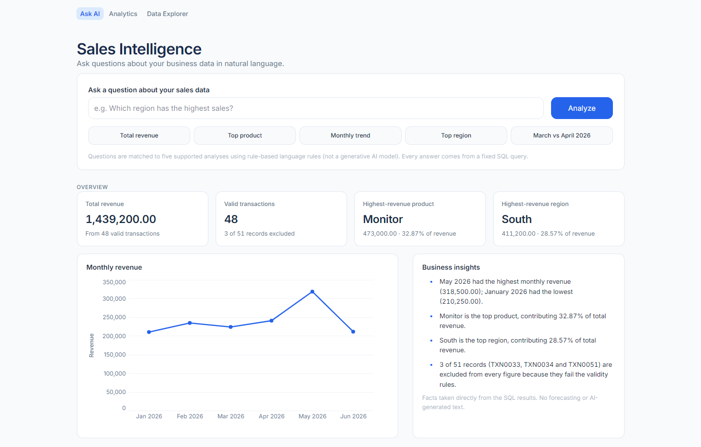

# Sales Intelligence: Mini AI Business Intelligence Assistant

Ask business questions about a sales CSV in plain English and get answers backed by real SQL queries.



Built for a Graduate Engineer Trainee selection challenge with Python, FastAPI, SQLite, Pandas, Streamlit and Pytest.

## Features

- **Natural-language questions** for five analytics operations: total revenue, top product, monthly trend, top region, and a month-to-month comparison.
- **Rule-based question interpreter.** It handles alternative phrasings, small typos, and month/year values like `March 2026`, `mar`, `2026-03` or `03/2026`. It is deterministic and needs no paid API.
- **Real SQL analytics.** Every number comes from a fixed, parameterised SQL query on SQLite. Nothing is calculated by an LLM.
- **Data cleaning and validation with Pandas.** It handles returned orders, zero quantities, missing prices, fixed-amount discounts and several date formats. No record is deleted or changed; invalid rows are flagged with a reason.
- **Data transparency.** Every answer reports how many records were used and excluded. The UI lists each excluded transaction and why it was excluded.
- **FastAPI backend** with Pydantic validation and clear HTTP errors (400 / 404 / 422 / 503).
- **Three-section Streamlit workspace** (blue theme, top navigation):
  - **Ask AI** (home): question box, five suggested questions, answers with charts and supporting figures, a "How this answer was calculated" section, session history, KPI cards, a monthly revenue chart and factual business insights.
  - **Analytics**: KPI cards, monthly revenue trend with a table, all seven products ranked, the four regions compared (exact values on every bar), business highlights and a data-quality summary.
  - **Data Explorer**: all 51 original transactions (valid and excluded) with search, region/product/status/month filters, sorting, pagination, highlighted excluded rows with their reasons, and CSV export of the filtered records.
- **196 automated tests** covering cleaning, the database, analytics, the interpreter, the API, transaction browsing and all three UI pages.

## Technology stack

| Layer | Technology | Purpose |
|---|---|---|
| Data cleaning | Pandas 2.3 | Read the CSV, convert types, flag invalid rows |
| Storage and analytics | SQLite (Python built-in `sqlite3`) | `sales` table, `valid_sales` view, SQL aggregations |
| Backend API | FastAPI 0.115 + Uvicorn + Pydantic | `/health`, `/ask`, `/summary`, `/data-quality`, `/transactions` |
| Frontend | Streamlit 1.48 + Altair (bundled with Streamlit) | Dashboard UI and charts |
| HTTP client | requests | Streamlit → FastAPI calls |
| Testing | Pytest, FastAPI `TestClient`, Streamlit `AppTest` | Automated tests |

## Project structure

```
mini-ai-bi-assistant/
├── backend/
│   ├── data_cleaning.py     # Pandas: load CSV, validate rows, flag invalid ones
│   ├── database.py          # SQLite: build sales table + valid_sales view
│   ├── analytics.py         # Fixed SQL analytics operations + dashboard summary
│   ├── transactions.py      # Read-only, parameterised transaction browsing
│   ├── question_parser.py   # Rule-based natural-language interpreter
│   └── main.py              # FastAPI app
├── ui/
│   ├── streamlit_app.py     # Entry point: page setup + top navigation
│   ├── views/
│   │   ├── ask.py           # Ask AI (home)
│   │   ├── analytics.py     # Analytics dashboard
│   │   └── explorer.py      # Data Explorer
│   ├── components.py        # Shared UI building blocks (cards, answers, KPIs)
│   ├── api_client.py        # HTTP calls to FastAPI + friendly error messages
│   ├── presentation.py      # Turns API data into tables and charts (no calculations)
│   └── styles.css           # Visual styling (layout, typography, components)
├── tests/                   # Pytest suite (196 tests)
├── data/
│   ├── sales.csv            # Source data (never modified by the app)
│   └── sales.db             # Generated SQLite database (git-ignored)
├── docs/
│   ├── ARCHITECTURE.md
│   ├── AI_DEVELOPMENT_REPORT.md
│   ├── INTERVIEW_NOTES.md
│   └── screenshots/
├── .streamlit/config.toml   # Theme (colours, Inter font, radii), hides error details
├── run_app.bat              # Starts API + UI (Windows)
├── start_api.bat
├── start_ui.bat
├── requirements.txt
└── pytest.ini
```

## Prerequisites

- **Python 3.11 or newer.** Developed and tested with Python 3.11.8. Tick "Add python.exe to PATH" when you install it.
- **Git**, to clone the repository.
- Windows 10/11. The `.bat` scripts are Windows-only; the manual commands below also work on macOS/Linux.

## Setup (Windows)

1. **Get the code**

   ```bat
   git clone <repository-url>
   cd mini-ai-bi-assistant
   ```

2. **(Recommended) Create and activate a virtual environment**

   ```bat
   python -m venv .venv
   .venv\Scripts\activate
   ```

   The `.bat` scripts use whichever `python` is on your PATH. Activate the virtual environment in the window where you run them.

3. **Install the dependencies**

   ```bat
   pip install -r requirements.txt
   ```

4. **Check the CSV is in place**

   The source data must be at `data/sales.csv`, with these columns:
   `Transaction_Id, Order_date, Product, Category, Region, Sales_channel, Quantity, Unit_price, Discount_amount, Status`

5. **Build the SQLite database**

   ```bat
   python -m backend.database
   ```

   Expected output:

   ```
   Loaded 51 rows into ...\data\sales.db
   Valid: 48, excluded: 3
     TXN0033: status is 'Returned', not Completed
     TXN0034: quantity is zero or negative
     TXN0051: missing or non-numeric unit price
   ```

   `start_api.bat` runs this step automatically if `data/sales.db` does not exist. **If you change the CSV, run this command again.** The API does not reload the CSV by itself.

## Running the application

### Option 1: one command (Windows)

```bat
run_app.bat
```

This opens two windows:

- **API:** http://127.0.0.1:8000 (interactive docs at http://127.0.0.1:8000/docs)
- **UI:** http://localhost:8501

Close both windows to stop the app.

### Option 2: manual commands

Open two terminals in the project folder, with the virtual environment activated if you use one.

```bat
:: Terminal 1 - backend
python -m uvicorn backend.main:app --host 127.0.0.1 --port 8000

:: Terminal 2 - frontend
python -m streamlit run ui\streamlit_app.py
```

The UI expects the API at `http://127.0.0.1:8000`. To use a different address, set an environment variable before starting Streamlit:

```bat
set BI_API_URL=http://127.0.0.1:9000
```

## Running the tests

```bat
python -m pytest
```

Expected result: `196 passed`. The tests build temporary databases, so they never touch `data/sales.db`. They do read the real `data/sales.csv` to check the actual figures.

| Test file | Tests | Covers |
|---|---|---|
| `test_data_cleaning.py` | 22 | Date parsing, every invalid-row rule, duplicates, real CSV profile |
| `test_database.py` | 7 | Loading, `valid_sales` view, revenue formula, NULL prices, rebuilds |
| `test_analytics.py` | 20 | All five operations, ties, zero-revenue months, missing months, dashboard summary, real figures |
| `test_question_parser.py` | 41 | ~20 phrasings, month/year extraction, typos, error cases |
| `test_api.py` | 23 | Every endpoint and status code, SQL text in questions, missing database, `/summary` vs direct SQL |
| `test_transactions.py` | 30 | Filters, search, combined filters, sorting, pagination, invalid rows, parameter validation, SQL text in filters |
| `test_frontend.py` | 53 | API client errors, chart/table helpers, CSV export, and all three pages via `AppTest` |

## Example questions

These five questions are built into the UI as suggestions. The answers below are the real results for `data/sales.csv`.

| Question | Answer |
|---|---|
| What is the total revenue? | Total revenue is 1,439,200.00 from 48 valid completed transactions. |
| Which product generated the highest revenue? | Monitor, with 473,000.00 |
| Show the monthly revenue trend | Highest in May 2026 (318,500.00), lowest in January 2026 (210,250.00) |
| Which region has the highest sales? | South, with 411,200.00 |
| Compare revenue between March 2026 and April 2026 | April 2026 (240,700.00) was 16,800.00 higher than March 2026 (223,900.00), a +7.50% change |

Other phrasings also work, for example "What is our best-selling product?", "Which area sold the most?", "Give me month-wise sales", "March vs April 2026", "Was April 2026 revenue higher than March 2026?" and "whats the totl revnue".

## API reference

Interactive Swagger docs are available at http://127.0.0.1:8000/docs while the API is running.

### `GET /health`

```json
{"status": "ok"}
```

### `GET /data-quality`

```json
{
  "total_rows": 51,
  "valid_rows": 48,
  "excluded_rows": 3,
  "excluded": [
    {"transaction_id": "TXN0033", "invalid_reason": "status is 'Returned', not Completed"},
    {"transaction_id": "TXN0034", "invalid_reason": "quantity is zero or negative"},
    {"transaction_id": "TXN0051", "invalid_reason": "missing or non-numeric unit price"}
  ]
}
```

### `GET /summary`

Dashboard figures used by the Ask AI overview and the Analytics page. It reuses the analytics functions; nothing extra is calculated except each leader's share of total revenue.

```json
{
  "total_revenue": 1439200.0,
  "transactions": 48,
  "top_product": {"names": ["Monitor"], "revenue": 473000.0, "share_pct": 32.87},
  "top_region":  {"names": ["South"],   "revenue": 411200.0, "share_pct": 28.57},
  "best_month":    {"month": "2026-05", "label": "May 2026", "revenue": 318500.0, "transactions": 8},
  "weakest_month": {"month": "2026-01", "label": "January 2026", "revenue": 210250.0, "transactions": 8},
  "monthly_trend":   ["... one entry per month ..."],
  "product_ranking": [{"name": "Monitor", "revenue": 473000.0, "transactions": 9}, "..."],
  "region_ranking":  [{"name": "South", "revenue": 411200.0, "transactions": 13}, "..."],
  "data_quality": {"total_rows": 51, "valid_rows": 48, "excluded_rows": 3, "excluded": ["..."]}
}
```

### `GET /transactions`

Browse every original transaction, valid and excluded. All parameters are optional.

| Parameter | Rules | Meaning |
|---|---|---|
| `search` | ≤ 50 chars | Case-insensitive match on transaction ID or product (`%` and `_` are literal) |
| `region`, `product`, `status` | ≤ 50 chars | Exact match |
| `month` | `YYYY-MM` | Order month |
| `sort` | `order_date`, `transaction_id`, `product`, `region`, `quantity`, `unit_price`, `revenue`, `status` | Sort column (default `order_date`) |
| `order` | `asc` / `desc` | Sort direction; missing values always sort last |
| `limit`, `offset` | 1–500, ≥ 0 | Pagination (default 25, 0) |

Example: `GET /transactions?month=2026-04&product=Keyboard`

```json
{
  "matching": 2, "matching_valid": 1, "matching_excluded": 1, "matching_revenue": 18900.0,
  "limit": 25, "offset": 0,
  "transactions": [
    {"transaction_id": "TXN0029", "order_date_raw": "14-04-2026", "quantity": 21, "unit_price": 900.0,
     "discount_amount": 0.0, "status": "Completed", "is_valid": true, "invalid_reason": null,
     "revenue": 18900.0, "...": "..."},
    {"transaction_id": "TXN0034", "order_date_raw": "28-04-2026", "quantity": 0, "unit_price": 900.0,
     "discount_amount": 0.0, "status": "Completed", "is_valid": false,
     "invalid_reason": "quantity is zero or negative", "revenue": null, "...": "..."}
  ]
}
```

`revenue` is `null` for excluded rows: it comes from the `valid_sales` view, so returned or invalid records are never counted. Invalid parameters return 422.

### `GET /transactions/filters`

Distinct values for the explorer dropdowns: `regions`, `products`, `statuses` and `months`.

### `POST /ask`

Request:

```json
{"question": "Which region has the highest sales?"}
```

`question` must be 1–500 characters after surrounding spaces are trimmed.

Response `200 OK`:

```json
{
  "question": "Which region has the highest sales?",
  "intent": "top_region",
  "answer": "The region with the highest revenue is South, with 411,200.00.",
  "data": {
    "top": ["South"],
    "top_revenue": 411200.0,
    "ranking": [
      {"name": "South", "revenue": 411200.0, "transactions": 13},
      {"name": "North", "revenue": 384450.0, "transactions": 14},
      {"name": "East",  "revenue": 346700.0, "transactions": 10},
      {"name": "West",  "revenue": 296850.0, "transactions": 11}
    ]
  },
  "chart_type": "bar",
  "data_quality": {"total_rows": 51, "valid_rows": 48, "excluded_rows": 3, "excluded": ["..."]}
}
```

| `intent` | `data` shape | `chart_type` |
|---|---|---|
| `total_revenue` | `{total_revenue, transactions}` | `null` |
| `top_product` / `top_region` | `{top: [names], top_revenue, ranking: [{name, revenue, transactions}]}` | `bar` |
| `monthly_trend` | `[{month: "2026-01", label: "January 2026", revenue, transactions}, ...]` | `line` |
| `compare_months` | `{months: [{month, label, revenue, transactions} x2], difference, percent_change}` | `bar` |

`top` is a list because ties are possible. `percent_change` is `null` when the earlier month has zero revenue.

Error responses:

| Status | When | Example body |
|---|---|---|
| 400 | Question not understood, or ambiguous | `{"detail": {"message": "Sorry, I don't understand that question yet.", "supported_questions": [...]}}` |
| 404 | A comparison month has no records at all | `{"detail": "There are no sales records for January 2025 in the dataset."}` |
| 422 | Empty, whitespace-only, missing or >500-character question | Standard FastAPI validation error |
| 503 | `data/sales.db` missing or has no tables | `` {"detail": "Sales database not found. Run `python -m backend.database` first."} `` |

## Data cleaning rules

The cleaning step (`backend/data_cleaning.py`) **never deletes, invents or edits a sales record**. It converts text to proper types and flags each row as valid or invalid with a reason. All 51 rows are stored in the `sales` table. Only valid rows appear in the `valid_sales` view, which every query uses.

A row counts toward revenue only if **all** of these are true:

| Rule | Otherwise |
|---|---|
| `Status` is `Completed` (case and surrounding spaces ignored) | Excluded: returned or other status |
| `Quantity` is a whole number greater than 0 | Excluded: zero, negative, decimal or non-numeric |
| `Unit_price` is present, numeric and ≥ 0 | Excluded: a missing price is stored as NULL and never guessed |
| `Discount_amount` is present, numeric, ≥ 0 and not larger than Quantity × Unit_price | Excluded |
| `Order_date` matches `DD-MM-YYYY`, `DD/MM/YYYY`, `YYYY-MM-DD` or `DD.MM.YYYY` | Excluded: unreadable or impossible date (e.g. 31-02-2026) |
| `Transaction_Id` is present and not a duplicate (the first occurrence is kept) | Excluded |

The original date text is kept in `order_date_raw`, and the CSV line number in `source_row`, so every row can be traced back.

### Revenue formula

```
Revenue = Quantity × Unit_price − Discount_amount
```

`Discount_amount` is a **fixed monetary amount, not a percentage**. Amounts are shown without a currency symbol because the dataset does not specify a currency.

### Data profile of `data/sales.csv`

- 51 transactions dated 3 January 2026 to 28 June 2026, all in `DD-MM-YYYY` format.
- 7 products, 3 categories, 4 regions, 2 sales channels.
- 3 excluded rows: TXN0033 (Returned), TXN0034 (quantity 0), TXN0051 (missing unit price).

## Known limitations

- **Limited question types.** The interpreter is rule-based, not a generative LLM. It only understands the five supported question types. It cannot answer, for example, "revenue in March" on its own, "lowest product", category or sales-channel breakdowns, or custom date ranges. Such questions get a helpful 400 message instead of a wrong answer.
- **Keyword matching can be fooled.** Any text containing a revenue word (such as "sales") is treated as a total-revenue question. This is safe, because no user text is ever executed, but it can answer a nonsensical question.
- **Dates are read day-first.** The source file uses day-first dates, so `01-02-2026` means 1 February, never 2 January.
- **A month without a year** (e.g. "March") is accepted only because the data covers a single year, or when the question writes the year once ("March and April 2026"). Otherwise the user is asked for the year.
- **A missing discount** makes the row invalid instead of being assumed to be 0. The current CSV has no missing discounts.
- **The database is not rebuilt automatically** when the CSV changes. Run `python -m backend.database` again.
- **No authentication or multi-user features.** It is designed to run locally.
- **Question history** lasts only for the current browser session. Earlier answers in the history omit the calculation section (Streamlit does not allow an expander inside another expander).
- **Data Explorer table:** sorting and paging are done by the API through the "Sort by" and page controls; the table itself is static, so column headers are not clickable. On laptop and phone widths the 12-column table scrolls sideways.
- **CSV export** is limited to 500 rows (the API's maximum page size); the dataset has 51.
- **The UI layout was checked only in headless Chrome** at desktop (1440 px), laptop (1024 px) and phone (390 px) widths. It has not been tested on real mobile devices or other browsers.
- **The Inter font loads from a CDN (jsDelivr).** Without internet access, the UI falls back to the system sans-serif font.
- **Scale.** It is designed and tested for a small dataset (51 rows). Larger datasets would work with SQLite, but performance has not been measured.

## Further documentation

- [Architecture](docs/ARCHITECTURE.md): design, data flow and security.
- [AI development report](docs/AI_DEVELOPMENT_REPORT.md): how AI tools were used and what was verified.
- [Interview notes](docs/INTERVIEW_NOTES.md): concepts and likely interview questions.
