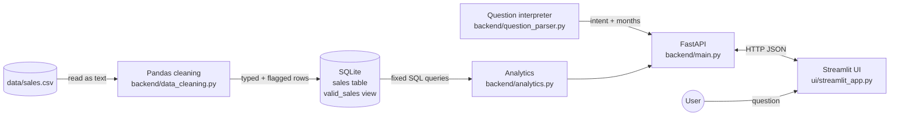

# Architecture

This document explains how the Mini AI Business Intelligence Assistant is put together and why each choice was made. The design goal was simple, reliable code that is easy to explain.

## Overview



There are two separate phases:

1. **Build time** (`python -m backend.database`): CSV → Pandas → SQLite. This runs once, or whenever the CSV changes.
2. **Question time** (every `/ask` request): Streamlit → FastAPI → interpreter → fixed SQL query → answer.

## The data pipeline step by step

### 1. CSV → Pandas (`backend/data_cleaning.py`)

- The CSV is read with `dtype=str`, so Pandas does not guess types. Blank cells and odd values stay exactly as written until the code decides what to do with them.
- `load_csv` checks that all 10 required columns exist and raises a clear `ValueError` if not.
- `clean_sales_data` builds a new DataFrame with **exactly one output row per input row**, in the same order:
  - Text fields are trimmed.
  - Numbers are converted with `pd.to_numeric(errors="coerce")`, so anything unreadable becomes missing (NaN) instead of crashing.
  - Dates are parsed by `parse_date`, which tries a fixed list of day-first or ISO formats and returns `YYYY-MM-DD` or `None`.
  - `find_problems` checks each row against the business rules and returns a list of reasons. An empty list means the row is valid.
  - Duplicate transaction IDs are flagged, except for the first occurrence.
- The output has two extra columns, `is_valid` and `invalid_reason`.

**Key decision:** invalid rows are *flagged, not deleted*. This keeps the "do not modify sales records" rule and makes data-quality reporting possible.

### 2. Pandas → SQLite (`backend/database.py`)

Two database objects are created:

```sql
CREATE TABLE sales (... every CSV row, plus is_valid and invalid_reason ...);

CREATE VIEW valid_sales AS
SELECT transaction_id, order_date,
       strftime('%Y-%m', order_date) AS order_month,
       product, category, region, sales_channel,
       quantity, unit_price, discount_amount,
       quantity * unit_price - discount_amount AS revenue
FROM sales
WHERE is_valid = 1;
```

- Rows are inserted with `executemany` and `?` placeholders.
- Missing values become SQL `NULL`, never `0`.
- Rebuilding drops and recreates the table and view inside a transaction, so running it twice never creates duplicate rows.
- **Why a view:** the revenue formula and the "only valid rows" rule live in exactly one place. Every analytics query reads `valid_sales`, so none of them can forget to exclude returned orders.

### 3. SQL analytics (`backend/analytics.py`)

| Function | SQL idea |
|---|---|
| `total_revenue` | `SELECT SUM(revenue), COUNT(*) FROM valid_sales` |
| `top_product` / `top_region` | `GROUP BY product/region ORDER BY revenue DESC`. All leaders are returned, so ties are reported. |
| `monthly_revenue_trend` | `GROUP BY order_month`. Python then fills every month between the first and last record, so a month with no valid sales shows as `0` instead of disappearing. |
| `compare_months` | `WHERE order_month = ?` for each month. It raises `NoDataError` if a month has no records at all, and returns `percent_change = None` when the baseline is zero. The earlier month is always the baseline. |

### 4. FastAPI (`backend/main.py`)

- `AskRequest` (Pydantic) trims the question and requires 1–500 characters. Anything else is a 422 error.
- `get_db` is a FastAPI dependency that opens the database **read-only** for one request and always closes it.
- `ask` looks up which years the data covers, calls the interpreter, sends the intent to one answer function, and returns a fixed response shape: `question`, `intent`, `answer`, `data`, `chart_type`, `data_quality`.
- The human-readable sentence is built in the backend, so every client gets the same wording.

### 5. Streamlit (`ui/`)

- `api_client.py` is the **only** place the UI talks to the backend, using `requests`. It turns every failure (server down, timeout, invalid JSON, 400/404/422/503/500) into an `ApiResult` with a friendly message.
- `presentation.py` reshapes API data into headline figures, tables and Altair charts. It does **not** recalculate anything.
- `streamlit_app.py` holds the layout and session state (question history).
- `.streamlit/config.toml` sets `showErrorDetails = "none"`, so Python tracebacks never reach the browser. A final `try/except` around `main()` shows a friendly message if something unexpected happens.

## The natural-language interpreter

`backend/question_parser.py` is **deterministic, rule-based language understanding, not a generative LLM**. The same question always gives the same result.

It works in four steps:

1. **Normalise:** lowercase the text and collapse spaces.
2. **Correct typos:** any word of 4+ letters that is not in the vocabulary is replaced by a very close vocabulary word using Python's built-in `difflib.get_close_matches` (cutoff 0.8). For example, "revnue" becomes "revenue" and "prodcut" becomes "product".
3. **Extract months** with regular expressions:
   - Accepted forms: `March 2026`, `mar`, `march, 2026`, `2026-03`, `03/2026`.
   - If the question names exactly one year, months without a year take that year ("March and April 2026").
   - Otherwise the API supplies a default year, but only when the dataset covers a single year.
   - "May" at the start of a question ("May I know…") is not treated as a month.
4. **Pick an intent** from keyword groups, in a fixed order:

   | Order | Rule | Result |
   |---|---|---|
   | 1 | Trend words ("monthly", "over time", "month-wise"), or "month" + "highest"/"lowest" | `monthly_trend` |
   | 2 | Exactly two months mentioned | `compare_months` |
   |   | One month, or more than two | Error: asks for exactly two months |
   | 3 | "lowest", "least" and similar | Error: not supported |
   | 4 | Product words + "highest" or revenue words | `top_product` |
   |   | Region words + "highest" or revenue words | `top_region` |
   |   | Both product and region | Error: ask separately |
   | 5 | Comparison words but no months | Error: asks which months |
   | 6 | Revenue or total words | `total_revenue` |
   | 7 | Anything else | Error: "I don't understand", plus the five example questions |

The output is a `ParsedQuestion(intent, months, error)`. Months are validated `YYYY-MM` strings. **The interpreter never produces SQL.**

## Security: SQL injection prevention and read-only access

| Risk | How it is prevented |
|---|---|
| User text reaching SQL | User text never becomes SQL. The interpreter only outputs one of five intent names and validated `YYYY-MM` strings. |
| Values inside queries | Month values are passed as bound `?` parameters (`WHERE order_month = ?`), never by string formatting. |
| Column names in `GROUP BY` | Column names cannot be bound parameters, so `_revenue_ranking` accepts only `"product"` or `"region"` from a hard-coded whitelist and raises `ValueError` for anything else. The value is chosen by code, never by the user. |
| LLM-generated SQL | Not used at all. No SQL is generated at run time. |
| The API changing data | The API opens SQLite with a `file:...?mode=ro` URI, so even a bug could not write to the database. A missing file returns 503 instead of silently creating an empty database. |
| Loading data | The build script uses `executemany` with `?` placeholders. |
| HTML injection in the UI | The question and answer are escaped with `html.escape` before being placed in custom HTML. |

Tests check this directly:

- `test_sql_in_question_is_never_executed` sends `'; DROP TABLE sales; --` to `/ask` and checks that all rows are still there.
- `test_unsupported_grouping_column_is_rejected` checks the column whitelist.
- `test_missing_database_is_503` checks that no empty database file is created.

## Why SQLite?

- **No setup.** It is part of Python's standard library and stores the database as one file. There is no server to install, configure or secure.
- **Real SQL.** The challenge asks for actual SQL analytics. SQLite supports `GROUP BY`, views, `strftime` date functions and parameterised queries.
- **Right size.** The dataset has 51 rows, and SQLite comfortably handles far more than that.
- **Easy to inspect.** Anyone can open `data/sales.db` with a SQLite browser and run the same queries.
- **Trade-off:** SQLite is not meant for many simultaneous writers. This app only reads at request time, so that does not matter here. A multi-user production system would probably use PostgreSQL.

## Why fixed SQL queries instead of LLM-generated SQL?

- **Correctness.** Each query was written once, reviewed and tested against hand-worked and independently computed figures. An LLM writing SQL could produce a slightly different, plausible-looking query each time, for example one that forgets to exclude returned orders.
- **Safety.** Running generated SQL is a security risk: it could read or change data it shouldn't. With fixed queries, the worst case for an unclear question is a 400 error.
- **Testability.** Five fixed functions can be fully unit-tested. Arbitrary generated SQL cannot.
- **Cost and reliability.** No API key, no network dependency and no per-request cost.
- **Trade-off:** only the supported question types can be answered. Adding a new one means adding a parser rule and a SQL function, which is deliberate, reviewed work.

## Error handling summary

| Situation | Backend | UI |
|---|---|---|
| Empty or too-long question | 422 (Pydantic) | Not sent if blank; otherwise "Please type a question (up to 500 characters)." |
| Unsupported or ambiguous question | 400 + message + example questions | Warning + a list of the supported questions |
| Comparison month not in data | 404 | Error message from the API |
| Month with records but zero valid revenue | 200; trend shows 0, percentage change is `null` | Shown as 0 / "n/a" |
| Database missing or broken | 503 | Message from the API |
| API not running or timing out | – | "Cannot reach the analytics server…" / "took too long" |
| Unexpected exception in the UI | – | Generic friendly message; tracebacks hidden by config |

## Testing strategy

- **Hand-written fixture data** (`tests/conftest.py`): 11 rows, one per edge case, with expected revenue worked out by hand (2×100−0, 3×50−20, 1×100−10 = 420). This is clearly labelled as test data, not sales data.
- **Real-data checks:** the actual `data/sales.csv` figures were first cross-checked with a separate Pandas calculation (not using the project's code), then fixed in tests as regression checks.
- **API tests** use FastAPI's `TestClient`, with the database path swapped through `app.dependency_overrides`.
- **UI tests** use Streamlit's `AppTest`. The page's HTTP calls are routed to the real FastAPI app, so a single test exercises Streamlit → api_client → FastAPI → SQLite.
